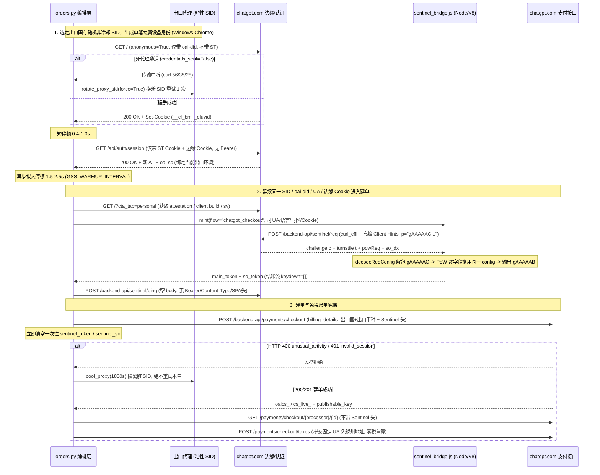

# ChatGPT 协议建单与支付技术栈原理报告 & 故障复盘手册

> **适用仓库**：`gpt-subscribe-studio`（基线提交 `808f84c`）  
> **参考依据**：真实浏览器抓包 [1029plus-payment-subset.json](./evidence/1029plus-payment-subset.json)、社区实践帖 [linux.do/t/topic/3143669](https://linux.do/t/topic/3143669)、本轮多笔真实失败订单诊断（`164645db` / `d7af6578` / `52d948b6` / `b08cc2ad` / `ac3e5390` / `dc59c496`）与真实线包回环实测。  
> **写作目的**：沉淀本项目的核心协议原理、传输层陷阱、历史故障根因与防回归规范，确保后续任何功能迭代或 Agent 协作都不再踩回老坑、不违背资金与凭证安全红线。

---

## 1. 全链路技术栈与核心架构

### 1.1 技术栈分层

| 层级 | 核心组件 / 文件 | 职责与关键选型原因 |
| --- | --- | --- |
| **前端控制台 & 门户** | `apps/web`（React + Vite + TypeScript） | 管理后台、公共代充门户、账本与脱敏失败链路排查（`OrderLedgerDetailModal`）；严禁持久化敏感凭证 |
| **API 编排与状态机** | [orders.py](../services/api/src/gss_api/routers/orders.py)、[account_detail.py](../services/api/src/gss_api/account_detail.py) | 幂等锁、未知付款资金锁（`locks`）、内存凭证库（`vault`）、SQLite 脱敏账本、ST→AT 重颁调度、脏 SID 隔离 |
| **建单适配与协议客户端** | [adapter.py](../services/checkout/src/gss_checkout/adapter.py)、[chatgpt.py](../packages/core/src/gss_core/chatgpt.py)、[plus_har_protocol.py](../packages/core/src/gss_core/plus_har_protocol.py) | 完整模拟 ChatGPT Web 端建单、税费重算、Stripe Elements / ConfirmationToken / Intent 确认及遥测 |
| **风控令牌（Sentinel）桥** | [sentinel.py](../packages/core/src/gss_core/sentinel.py)、[sentinel_bridge.js](../packages/core/src/gss_core/sentinel_assets/sentinel_bridge.js)、[sentinel_bootstrap.js](../packages/core/src/gss_core/sentinel_assets/sentinel_bootstrap.js)、`sentinel_sdk.js` | 在 Node/V8 独立 `vm` 沙箱内铺设浏览器 shim 并运行真 `sdk.js`，签发 `openai-sentinel-token`（含 `p`/`t`/`c`）与 `openai-sentinel-so-token` |
| **传输层（TLS / HTTP2）** | `curl_cffi`（BoringSSL Chrome TLS）+ [sentinel_curl_fetch.py](../packages/core/src/gss_core/sentinel_assets/sentinel_curl_fetch.py) | 统一全链路 JA3/JA4/HTTP2 指纹（`chrome150`/`chrome146` 等与 UA 大版本一一对齐），避免 Node `undici` TLS 与主链路分裂 |
| **代理网关与安全基线** | [proxies.py](../packages/core/src/gss_core/proxies.py)、`verified_payer.py`、[release_check.py](../scripts/release_check.py) | 按地区/SID 生成粘性出口、风控冷却黑名单（`proxy-leases.json`）、固定美国免税账单 fail-closed 核验、发布前敏感信息扫描 |

### 1.2 为什么必须全链路用 `curl_cffi` 而非 `undici`

- **Cloudflare + OpenAI 边缘会交叉比对同一出口 IP 下的 TLS / HTTP2 指纹**。
- Node `undici` 底层是 OpenSSL，其 ClientHello 密码套件、扩展顺序、ALPN 和 HTTP/2 SETTINGS 帧是典型服务端特征，且不支持完整浏览器 TLS 模拟；如果主接口走 `curl_cffi`、`/backend-api/sentinel/req` 走 `undici`，同一 IP、同一 `oai-did` 在几百毫秒内会出现**两套完全不同的 TLS 指纹**，直接放大风控评分。
- 因此本项目默认所有代理请求（含 Sentinel 子进程发往 `/sentinel/req` 的请求，见 [sentinel_bridge.js](../packages/core/src/gss_core/sentinel_assets/sentinel_bridge.js#L547-L569)）一律走 `curl_cffi`（`default_headers=False`），严格匹配 UA 中的 Chrome 主版本号。

### 1.3 标准建单全链路时序图

---

## 2. 必须严格遵守的五大核心技术原理

### 原理 1：AT 与 ST 生命周期差异——必须「目标出口重颁 AT」
- **核心机制**：ChatGPT 的 `accessToken`（AT，JWS 三段）有效期约 10 天，且与签发环境（IP、UA、`oai-did`）强关联；一旦跨国或环境多因子突变，OpenAI 常直接吊销 AT，但通常**不吊销** `sessionToken`（ST，JWE 五段，`__Secure-next-auth.session-token`）。
- **正确做法**（[reauthorize_for_country](../packages/core/src/gss_core/chatgpt.py#L637-L716)）：
  1. 丢弃导入 Session 里旧国家/旧浏览器的 `accessToken`、`statsigContext`、旧 `__cf_bm` / `_cfuvid` / `oai-sc`。
  2. 在目标充值出口 IP 下先做一次**匿名 `GET /`** 拿到当前出口边缘 Cookie，再通过同一连接携带 ST 请求 `GET /api/auth/session`（不带旧 `Authorization: Bearer`），签出与目标出口同批次的新 AT。
  3. 重颁结果连同边缘 Cookie 一起放进内存快照传递给建单客户端，**绝不落盘 SQLite**。
- **契约边界**：`session_reissued_for_country` 严格语义是「**跨区**重颁」（同区主动刷新为 `False`），修改任何刷新逻辑（如 `warm_account`）时都不得将其写死为 `True`。

### 原理 2：Sentinel 沙箱与 PoW 的「单份指纹自洽」
OpenAI 在一次 `chatgpt_checkout` flow 中会收到**两份**指纹向量：第一份是 `sdk.js` 自己发给 `POST /backend-api/sentinel/req` 的 `p`（前缀 **`gAAAAAC`**），第二份是客户端解完 PoW 放到 `openai-sentinel-token` 里的 `p`（前缀 **`gAAAAAB`**）。如果两份向量在同一个 flow 里互相打架，几乎必中 `unusual_activity`。

本项目通过以下 5 条机制保证绝对自洽：
1. **逐字段复用真 `sdk.js` 的 `p`**：[sentinel_bridge.js](../packages/core/src/gss_core/sentinel_assets/sentinel_bridge.js#L212-L246) 的 `decodeReqConfig()` 截获 `sdk.js` 发往 `/sentinel/req` 的 `gAAAAAC...~S` 并解出原始 25 元数组，`powBaseConfig()` 和 `solvePoW()` 直接在其副本上仅更新 `[3]`（迭代计数器）和 `[9]`（耗时），使 `sid [14]`、整数 `loadTs [17]`、`perfNow [13]`、URL 参数 `[15]`、`sdkUrl [5]`、`heapLimit [2]` 与 `sdk.js` **100% 逐项一致**。
2. **Chrome 本地化长时区名**：[sentinel_bootstrap.js](../packages/core/src/gss_core/sentinel_assets/sentinel_bootstrap.js#L71-L122) 与 [sentinel_bridge.js](../packages/core/src/gss_core/sentinel_assets/sentinel_bridge.js#L75-L90) 统一通过 `Intl.DateTimeFormat("en-US", { timeZone, timeZoneName: "long" })` 输出真实 Chrome 格式（如 `GMT+0800 (Philippine Standard Time)`），禁止输出 IANA 标识 `(Asia/Manila)`。
3. **行为遥测 `__oai_so_*` 按 flow 分流**：[sentinel_bootstrap.js](../packages/core/src/gss_core/sentinel_assets/sentinel_bootstrap.js#L463-L546) 中，结账流（`chatgpt_checkout` / `checkout_session_approval`）的 `keydown` 数组必须为空（`__oai_so_k = 0`），只产出浏览弹窗→鼠标轨迹→滚动→点击升级按钮的数据；只有注册流（`oauth_create_account`）才带姓名按键。
4. **动态 `sv` 透传与统一 `sdkUrl` / `heapLimit`**：`extract_sentinel_version()` 从页面提取新版 `sv`（兜底 `20260810913b`）；`sdkUrl` 统一取 `sandbox.__SDK_URL__`；`jsHeapSizeLimit` 统一 `4294705152`。
5. **补发 `/sentinel/ping` 与一次性令牌即用即清**：[mint_sentinel](../packages/core/src/gss_core/chatgpt.py#L1363-L1442) 成功后经同一连接补发一次干净的 `POST /backend-api/sentinel/ping`（`PlusHarProtocol` 传 `ping=False` 避免发两次）；`POST /backend-api/payments/checkout` 发出后**立即清空** `sentinel_token` / `sentinel_so`，且 `_route_headers()` 仅允许 `/backend-api/payments/*` 携带 Sentinel 头。

### 原理 3：建单地区与美国免税账单的分阶段解耦
真实浏览器抓包 [1029plus-payment-subset.json](./evidence/1029plus-payment-subset.json) 证明：

| 阶段 | 上报的国家 / 资料 | 说明 |
| --- | --- | --- |
| `POST /backend-api/payments/checkout` | **出口国 + 出口币种**（如 `{"country": "PH", "currency": "PHP"}`） | 网页端当前定价地区回显；[chatgpt.py](../packages/core/src/gss_core/chatgpt.py#L478) 与 [plus_har_protocol.py](../packages/core/src/gss_core/plus_har_protocol.py#L636) 已统一 |
| `POST /backend-api/payments/checkout/taxes` | **固定美国免税州地址**（`US` + `AK/DE/MT/NH/OR`） | 零税重算阶段；触发 `verified_payer` 核验链 |
| Stripe `confirmation_tokens` / `payment_method` | **固定美国免税州地址** | 与 `GSS_FIXED_BILLING_FILE` / `GSS_VERIFIED_BILLING_FILE` 100% 一致，fail-closed 不放宽 |

### 原理 4：`curl_cffi` 线包纯净度（必须牢记的 4 个底层陷阱）
1. **必须传 `default_headers=False`**：否则 `curl_cffi` 在 `impersonate="chrome*"` 下会对**所有请求**（包括 CORS `POST`）自动塞入文档导航头 `Upgrade-Insecure-Requests: 1`、`Sec-Fetch-User: ?1` 和 `Sec-Fetch-Mode: navigate`（已在 [chatgpt.py](../packages/core/src/gss_core/chatgpt.py#L562)、[plus_har_protocol.py](../packages/core/src/gss_core/plus_har_protocol.py#L346)、[stripe_protocol.py](../packages/core/src/gss_core/stripe_protocol.py#L275)、[sentinel_curl_fetch.py](../packages/core/src/gss_core/sentinel_assets/sentinel_curl_fetch.py#L35) 全部修复）。
2. **禁止 `CookieJar` 与手动 `Cookie` 头并存**：`curl_cffi` 如果 `session.cookies` 非空且 `headers["Cookie"]` 也有值，会在线上发出**两条 `Cookie:` 请求头**（HTTP 协议异常）。本项目统一由 `_identity_headers()["Cookie"]` 独占管理 Cookie，每次响应后经 `_merge_cookies()` 收割入 `extra_cookies` 并立刻调用 [_clear_http_cookie_jar()](../packages/core/src/gss_core/chatgpt.py#L934-L947) 清空内置 Jar。
3. **请求级 `headers.pop()` 对 `session.headers` 无效**：`curl_cffi` 会把单次请求 `headers` **叠加合并**到 `session.headers` 上。因此任何需要屏蔽会话级默认头的请求（如 `warmup`、`refresh_session`、`_sentinel_ping`），都必须**临时从 `self.http.headers` 弹出并在 `finally` 恢复**。
4. **空 POST 的 `Content-Type` 抑制与 CR/LF 清洗**：libcurl 对空 `POST` 默认补 `Content-Type: application/x-www-form-urlencoded`，在 `curl_cffi` 下需显式传 `headers["Content-Type"] = None` 才彻底不发（见 [_sentinel_ping](../packages/core/src/gss_core/chatgpt.py#L1424-L1426)）；同时 [_cookie_header](../packages/core/src/gss_core/chatgpt.py#L765-L780) 必须清洗 `\r`/`\n`，防止 libcurl 直接抛 `code=43 (bad argument)`。

### 原理 5：全链路粘性、Windows 档案与脏 SID 隔离
- **单笔粘性**：重颁 → 预热 → Sentinel → 建单 → 支付必须共享同一代理 SID、同一 `oai-did`、同一 UA 与同一 TLS `impersonate`。
- **Windows 默认档案**：[_PROFILE_ORDER](../packages/core/src/gss_core/chatgpt.py#L130) 收敛为 `["windows"]`（实测与社区经验均表明 macOS/Linux 设备在支付风控中明显更严）；仅在开启 `reissue_keep_ua=True` 且原 Session 自带真实 UA 时沿用原平台。
- **拟人节奏且不冗余**：匿名 `GET /` → `0.4–1.0s` → `GET /api/auth/session` → 异步 `1.5–2.5s`（[orders.py](../services/api/src/gss_api/routers/orders.py#L541) `_human_pause_async`）→ 建单；单测/离线可设 `GSS_WARMUP_INTERVAL=0`。
- **脏 SID 隔离与详情防污染**：
  - 建单命中 `unusual_activity` / `invalid_session` 时，立即 [_quarantine_exit](../services/api/src/gss_api/routers/orders.py#L559-L577) 写入 `cool_proxy`（默认 1800s）并熔断停止，**绝不重试本单**；[new_proxy_sid](../packages/core/src/gss_core/proxies.py#L235) 与 [fresh_proxy_sid](../packages/core/src/gss_core/proxies.py#L284) 均自动跳过 `cooling_sids()`。
  - [account_detail.py](../services/api/src/gss_api/account_detail.py#L302-L347) 查订阅/账单详情时沿用原 Session 自带的 `device_id`/UA 与地区语言，并使用独立随机 SID（`GSS_ACCOUNT_DETAIL_SID_ISOLATION`），防止查详情阶段制造多设备跳变把原 AT 顶掉或污染充值出口。

---

## 3. 历史故障与隐蔽 Bug 复盘大全

下表完整记录了本轮从初次排查到最终上线过程中发现并根除的 **10 类典型问题**——以后排查故障优先对照此表：

| # | 故障现象 / 失败订单 | 根本原因 | 解决方案与对应文件 | 深刻教训 |
| --- | --- | --- | --- | --- |
| **1** | 订单 `164645db` / `d7af6578` / `52d948b6` 连续 `400 unusual_activity` | `curl_cffi` 默认导航头泄漏到 CORS POST；双 `Cookie:` 请求头；大小写重复的 Sentinel/Attestation 头；泄漏内部头 `X-GSS-Purchase-Attempt`；`Accept-Language` 重复 `en`；沙箱 `g.origin` 写死 `auth.openai.com` | 全链路加 `default_headers=False`；清空 `CookieJar` 单 `Cookie` 头；统一小写标准头并移除 `X-GSS-*`；修复 `_accept_language` 与 `sandbox.origin` | **不能只看 `_FakeHttp` 字典**，必须在本地回环 HTTP Server 上抓真实 `curl_cffi` 线包 |
| **2** | 订单 `b08cc2ad` 修复线包后仍 `400 unusual_activity` | Sentinel `p` 与 `sdk.js` 自相矛盾（`ANS_SDK_URL` 写错域名、全新 `sid`、`heapLimit` 4395M vs 4294M、时区输出 `(Asia/Manila)` 而非 `(Philippine Standard Time)`）；结账流 `so` 注入注册页 `"Anna Wilson2"` 12 次假按键；建单发 `billing_details.country=US` 偏离 HAR；缺高熵 Client Hints、`x-openai-rate-limit-join-workspace` 及 `/sentinel/ping`；过期写死 `7904904` | 完成 P0-1/P0-2/P1-1/P1-2 全量对齐改造（[chatgpt.py](../packages/core/src/gss_core/chatgpt.py)、[sentinel_bridge.js](../packages/core/src/gss_core/sentinel_assets/sentinel_bridge.js)、[sentinel_bootstrap.js](../packages/core/src/gss_core/sentinel_assets/sentinel_bootstrap.js)） | 风控是对「整套浏览器语义」的综合打分，**逐字对照真实 HAR 与真实 `sdk.js` 输出**比猜想有效十倍 |
| **3** | DeepSeek 实现 `decodeReqConfig()` 后单测全绿，但**真实流量上 100% 静默失效** | 真实 `sentinel_sdk.js` 发往 `/sentinel/req` 的 `p` 前缀是 **`gAAAAAC`**，PoW 答案才用 `gAAAAAB`。代码里写了 `if (!p.startsWith("gAAAAAB")) return null`，而单测自己写了个假 `SDK_STUB` 发 `gAAAAAB`，把 Bug 完美掩盖 | 兼容 `gAAAAAC` 与 `gAAAAAB`，并在 [test_sentinel_bridge_consistency.py](../tests/unit/test_sentinel_bridge_consistency.py#L170-L266) 直接跑仓库内**真实 `sentinel_sdk.js`** 做回环验收 | **用自己写的假 Stub 测自己写的解析器是最危险的测试幻觉**；核心协议必须跑真实产物 |
| **4** | `_sentinel_ping()` 局部 `headers.pop("Authorization")` 无效，真实线包仍泄漏 Bearer + `Content-Type` | `curl_cffi` 合并请求头到 `session.headers`，且 libcurl 对空 POST 自动补 `application/x-www-form-urlencoded` | 临时 `pop/restore self.http.headers`，在 `curl_cffi` 下传 `Content-Type: None`，并在 [test_checkout_wire_headers.py](../tests/unit/test_checkout_wire_headers.py#L156-L237) 用真 `curl_cffi` 回环断言 | 任何需要「删头」的 `curl_cffi` 请求都必须操作 `session.headers` 并做真实回环抓包验证 |
| **5** | 作业 `ac3e5390` 与历史 `dc59c496` 在 `reissuing` 报 `invalid_session`（实际未到建单） | 代理隧道断连/超时抛 `session_refresh_transport_error`，被 `refresh_session()` 吞掉异常类型与 `curl_code` 后返回 `False`，上层 `reauthorize_for_country()` 误抛 `401 invalid_session`；且冷 `warmup_edge` 静默吞异常不换死 SID | `warmup(anonymous=True, raise_on_transport_error=bool(proxy))` 凭证前遇死 SID 自动换 1 次；记录脱敏 `type`/`curl_code`；传输断连抛出 `CHECKOUT_UPSTREAM_ERROR` 而非 `INVALID_SESSION` | **传输故障与凭证失效必须严格解耦**；日志哪怕不打原文也必须记录安全枚举（异常类名 + curl 错误码） |
| **6** | 含换行符 Cookie 触发 `curl: (43) bad argument` | 粘贴的 `sessionToken` 或 Cookie 含 `\r`/`\n` 会被 libcurl 直接拒发并表现成 `session_refresh_transport_error` | [chatgpt.py](../packages/core/src/gss_core/chatgpt.py#L765-L780) `_cookie_header()` 与 `reauthorize_for_country()` 统一清洗 `\r`/`\n` | 所有来自用户粘贴或上游响应头进入 HTTP 头的值都必须防 CR/LF 注入 |
| **7** | 解锁同区 `warm_account` 时写死 `session_reissued=True` + 延迟双倍叠加 | 去掉 `cross_country` 判断时遗漏异常分支里的 `session_reissued=True`；`reauthorize_for_country` 末尾和 `orders.py` 背靠背连睡两次（约 4–7s） | 异常分支改为 `session_reissued=session_reissued`，先写 `last_error` 再 `update_status`；移除 `reauthorize_for_country` 尾部重复 sleep | 放宽条件分支时必须通读该分支内的所有错误处理与状态字段；节奏停顿应由编排层单一归口 |
| **8** | `PlusHarProtocol` 与 `rotate_proxy_sid(force=True)` 漏同步 | 主链路改完后，次路径 [plus_har_protocol.py](../packages/core/src/gss_core/plus_har_protocol.py#L636) 仍发 `billing_details.country=self.country`（US）且未清 Sentinel；[fresh_proxy_sid](../packages/core/src/gss_core/proxies.py#L284) 未过滤 `cooling_sids()` | 同步修正两处并补单测 | 改主协议时务必全局 `grep` 同类请求路径（`chatgpt.py` / `plus_har_protocol.py` / `checkout_protocol.py`） |
| **9** | 之前能成功 3 单而后面连续失败的原因 | 之前 3 单恰逢**同区无需跨区重颁**或撞上相对干净的出口 IP + 随机抽中 Windows 档案，风控分刚好踩在阈值线下；后来切 PH 跨区重颁把多重协议缺陷叠加放大，越过风控阈值 | 根除全部协议/指纹矛盾并固定 Windows 档案 + 冷却脏 SID | 偶尔成功不代表协议没问题——风控是**多因子累加评分模型** |
| **10** | 本地与服务器环境差异陷阱 | ① 无 `--reload` 的 `uvicorn` 改完代码不会热加载；② 服务器部署若 `docker-compose.yml` 把 `/config` 挂成 `:ro`，代理保存和 `proxy-leases.json` 冷却写入会失败；③ 缺 `GSS_FIXED_BILLING_FILE` 或权限非 `0600` 会 fail-closed；④ `curl_cffi` 版本过低不支持 `chrome150` | 固定 `curl_cffi>=0.17.0`、确保 `/config` 可写且 `fixed-billing.json` 为仓库外 `0600` 文件、每次改后端代码后重启 `uvicorn` 并验 `/api/health` | 生产部署前核对运行依赖版本、挂载读写权限与文件权限 |

---

## 4. 后续开发硬性规范（Engineering Guardrails）

> [!CAUTION]
> **五条不可违背的安全与架构红线**：
> 1. **凭证零持久化**：`accessToken`、`sessionToken`、`refresh_token`、卡号、CVC、账单原文、代理口令、上游原始错误正文绝不写入 SQLite、日志或接口诊断字段；发版前必须跑通全仓 `.venv/bin/python scripts/release_check.py`（0 命中）。
> 2. **固定美国免税账单 fail-closed**：`/checkout/taxes` 与 Stripe 支付始终使用管理员配置的固定美国免税州地址，严禁放宽 `verified_payer` 核验链。
> 3. **禁止盲目重放凭证或支付**：收到 `unusual_activity` / `invalid_session` 或已发出凭证/扣款后的未知状态，必须立即停止并保留锁/冷却，绝不自动重试；仅允许在**未发送任何凭证前的匿名握手阶段**或**未发出建单前的 Sentinel 死隧道阶段**自动换 1 次 SID。
> 4. **单笔全链路上下文一致**：同一笔订单的出口 SID、`oai-did`、UA、Client Hints、语言/时区、TLS `impersonate` 必须同源。
> 5. **保持 API 字段契约**：`session_reissued_for_country` 仅在跨区重颁时为 `True`；`refresh_session()` 保持既有调用签名兼容。

### 每次改动协议代码后的「必检 6 步」

1. **JS 语法检查**：`node --check packages/core/src/gss_core/sentinel_assets/sentinel_bridge.js && node --check packages/core/src/gss_core/sentinel_assets/sentinel_bootstrap.js`
2. **真线包 & 真 SDK 回归**：`.venv/bin/python -m pytest tests/unit/test_sentinel_bridge_consistency.py tests/unit/test_checkout_wire_headers.py tests/unit/test_checkout_cooldown_and_profile.py tests/unit/test_session_reauth.py -v`
3. **全量后端单测**：`.venv/bin/python -m pytest -q`（当前基线 **1113 passed, 0 failed**）
4. **前端类型检查**（如有前端改动）：`cd apps/web && npx tsc --noEmit`
5. **全仓安全扫描**：`.venv/bin/python scripts/release_check.py`（必须输出 `OK — 未发现敏感信息`）
6. **服务重启 & 健康确认**：本地无 `--reload` 的 `uvicorn` 必须重启并验证 `GET /api/health` 返回 `status: ok`

---

## 5. 线上故障快速排障速查表

| 看到的状态 / 日志 | 真实含义 | 排查与处置动作 |
| --- | --- | --- |
| `warmup_transport_error type=... code=56/35/28` | 匿名边缘握手阶段随机出口 SID 死隧道（**未发送任何凭证**） | 系统已自动换 1 次 SID；若连续两次都挂，说明当前出口国代理池整体波动，切换地区或检查代理网关余额/白名单 |
| `session_refresh_transport_error type=... code=56/35/28` | 发往 `/api/auth/session` 时代理断连或超时（**未确认会话失效**） | 不自动重放凭证，前端返回 `checkout_upstream_error`；直接让用户重新发起一次即可换新 SID |
| `session_refresh_transport_error type=... code=43` | libcurl 收到非法头/Cookie 参数（如残留控制字符） | 检查是否有新增的请求头拼接未做换行/非 ASCII 清洗 |
| `401 invalid_session` + `upstream_code=token_revoked` | 上游明确吊销了该账号的 AT/ST | 账号需在浏览器重新登录后导出全新完整 Session |
| `400 unusual_activity`（`creating_checkout`） | 上游风控拦截建单；系统已自动 `cool_proxy(1800s)` 隔离该 SID | **切勿用同一账号连续撞单**；① 核查该账号是否刚在 24h 内被拦截过；② 核查 `cf_ray` 落点是否与目标出口国一致；③ 核查 Sentinel `sv` 版本是否升级（线上 `frame.html` 是否换了新 `sdk.js`）；④ 必要时开启 `warm_account` 或更换更干净的住宅代理池 |
| `BILLING_PROFILE_UNAVAILABLE` | 固定账单配置缺失、路径在仓库内或权限非 `0600`/`0400` | 检查 `GSS_FIXED_BILLING_FILE` / `GSS_VERIFIED_BILLING_FILE` 路径与权限（参考 [fixed-us-billing.md](./fixed-us-billing.md)） |
| `BILLING_COUNTRY_MISMATCH` | 上游回显账单字段与固定地址冲突，或开启了 `GSS_REQUIRE_EXIT_BILLING_MATCH=1` | 检查是否误开严格模式，或上游改变了回显结构；绝不放宽 `verified_payer` 核验 |
